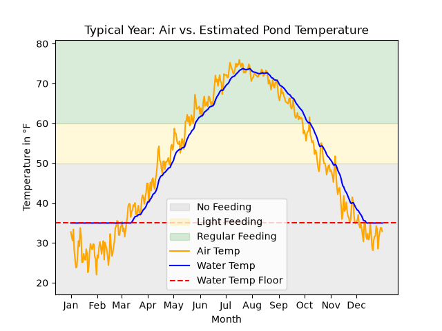

# Koi Seasons

A procedurally rendered koi pond that changes through the year, driven by real weather data. Drag
a slider through the seasons: koi slow down and sink deep in winter, ice forms on the surface, and summer brings faster
swimming and an algae tint.

**Status:** In progress, Phase 1 complete (data pipeline)



## Planned Stack

- **Data:** Python, pandas, NumPy
- **Prototyping visuals:** NumPy, Matplotlib, Pillow
- **Browser rendering:** GLSL shaders, three.js
- **Interface and charts:** JavaScript, D3.js, HTML/CSS

## Project Structure

```
data/        raw NOAA data and processed daily JSON
python/      data pipeline and NumPy render prototypes
web/         browser version (shaders, slider, charts)
docs/        data contract, images, GIFs
```

## Data

### Source

Daily temperatures from NOAA station **USW00004789** (Montgomery Orange County Airport, NY),
the closest station to the farm with a nearly complete record, covering 2015–2025.

### Pipeline

The pipeline runs in two steps:

1. **`python/data/clean_data.py`** filters the raw NOAA export to one station, removes
   February 29 and duplicate dates, interpolates missing daily highs and lows, and fills
   missing daily averages with their midpoint. It validates the result and saves
   `data/processed/clean_data.csv`.
2. **`python/data/build_year.py`** averages each calendar day across all years into one
   365-day typical year, estimates pond water temperature, derives koi behavior, validates
   the result against the data contract, and exports `data/processed/pond_year.json`.

### Water temperature model

Pond water follows air temperature, but slower and smoother. Each day, the water moves a
fixed fraction of the way toward the air temperature (exponential smoothing):

```
water(t) = α · air(t) + (1 − α) · water(t − 1)
```

- **α = 0.1**, roughly a 10-day lag behind the air.
- **Wraparound:** the year is run twice so January starts with December's history.
- **Winter floor of 35°F:** the water where koi overwinter stays above freezing, since ice
  insulates the water below.

The model only sees air temperature. It ignores sunlight, pond depth, and groundwater, and
will be calibrated against real readings from the farm.

### Koi behavior

Derived from water temperature (air temperature for ice). Thresholds are currently
placeholders based on general koi-keeping guidance:

| Field      | Rule                                                             |
|------------|------------------------------------------------------------------|
| `activity` | 0 at or below 45°F, 1 at or above 72°F, linear in between        |
| `feeding`  | none below 50°F, light from 50 to 60°F, regular at or above 60°F |
| `ice`      | fraction of the last 7 days with air at or below 32°F            |
| `algae`    | 0 at or below 60°F, 1 at or above 78°F, linear in between        |

## Data Contract

Daily values shared between the data pipeline and the visuals are defined
in [docs/data-contract.md](docs/data-contract.md).

## Setup

```bash
python -m venv .venv
source .venv/bin/activate   # Windows: .venv\Scripts\activate
pip install -r requirements.txt
```

## Run the Pipeline

```bash
python python/data/clean_data.py
python python/data/build_year.py
```

## License

MIT
